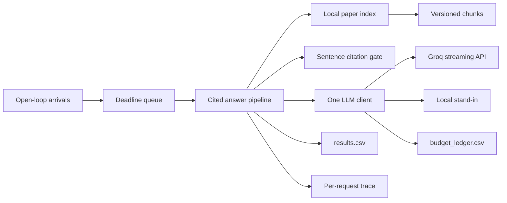
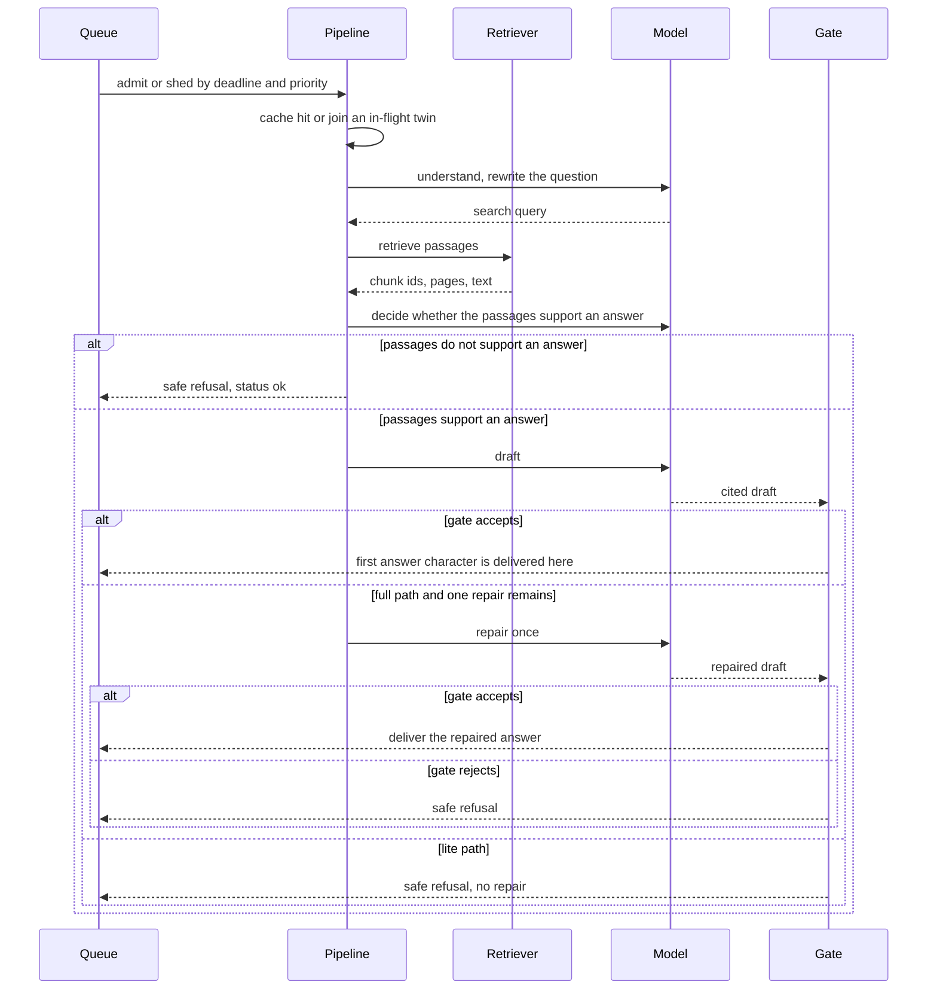
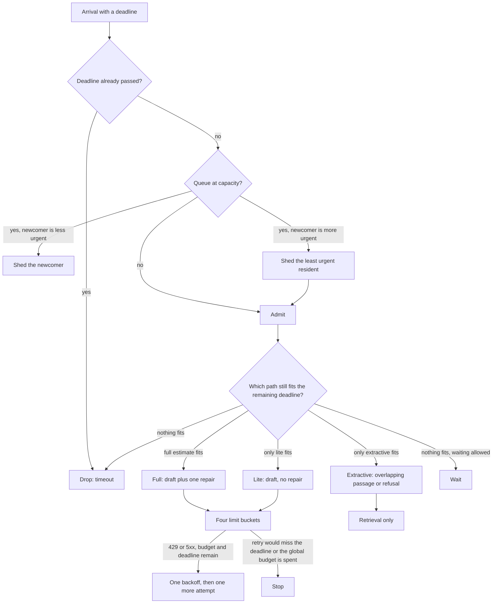
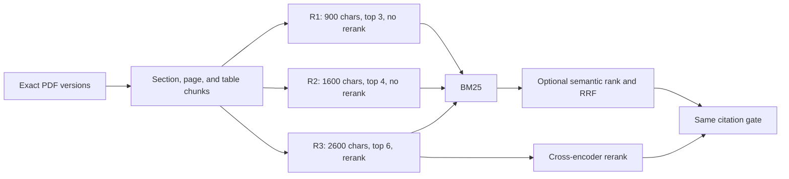
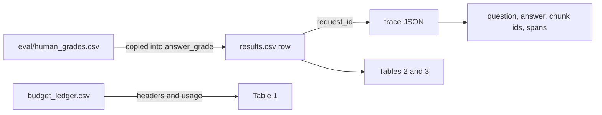

# The Relay

This is the system-design record that does not fit in the two-page write-up. The write-up in `WRITEUP.md` is the graded narrative and the required tables. This file is the architecture: what I built, why each control exists, and what I refused to pretend was measured.

The product is a cited paper assistant. It may answer only from three exact arXiv versions: Attention Is All You Need `1706.03762v7`, Moshi `2410.00037v1`, and Dynamic Chunking `2507.07955v2`. Four goals pull against each other: a fast first token, a correct cited answer, a small bill, and nobody turned away. I treated the citation gate as the decision that shapes the rest. A fluent sentence is not an answer until its citation was retrieved and its numbers and named terms appear in that passage.

## Competing goals

| Goal | What I protect | What I give up |
| --- | --- | --- |
| Never send a wrong answer | Sentence gate, safe refusal, one repair only on the full path | Many answerable questions come back as refusals |
| Fast first token | Lite path skips repair; extractive path skips drafting | A weaker or shorter answer |
| Stay inside the provider | Header buckets, a global retry budget, approval before a real call | I do not drain the daily quota to finish a chart |
| Nobody turned away | Deadline queue, shedding the least urgent request, a refusal instead of silence | A shed or expired request is a timeout, not a success |

Measured numbers live in `WRITEUP.md` and `results/results.csv`. Planning numbers in `config/*.yaml` that are marked `UNVERIFIED` are hypotheses. I do not treat them as Groq limits.

## System context



One client talks to both backends. Groq is used for the measurements that have to be real: header limits, the five-request steady run, and the 15-question quality comparison. The stand-in is used for burst, sustained overload, a halved per-minute ceiling, and a daily budget that runs out. The stand-in is not a stand-in for those Groq numbers.

## Request path



The first token in the tables is the first character of the answer the user receives after the gate. A provider token that arrives during drafting does not count. On the slow real steady request, the trace is 0.0 ms waiting, 3174.0 ms working, and 0.0 ms retrying, and all of that work is before the refusal is delivered. Provider time-to-first-token is stored on the span. It is not the user-visible number.

The safe refusal is fixed text: "I couldn't find support for this question in the passages I retrieved, so I can't answer it without guessing."

## Control plane



Lower numeric priority is more urgent. A full queue keeps the more urgent request and sheds the other. An arrival whose deadline has already passed is not queued. I did not record queue length in the traces, so peak queue in the tables is `not measured`. I will not backfill it.

The ladder in `relay/scheduler.py` walks `full`, then `lite`, then `extractive`. The planning times in `config/scheduler.yaml` are 6.0 s, 3.0 s, and 0.5 s. Those three numbers are labeled unverified. The published daily-budget stand-in run was level `lite`, so the repair was skipped. That is a scheduler outcome on the stand-in, not proof that 3.0 s is Groq's lite latency.

Extractive mode does not call the drafter. It returns a retrieved passage only when the question and the passage share enough lexical overlap. Otherwise it refuses.

## Limits, retries, and cache

The limiter keeps four buckets: requests per minute, tokens per minute, requests per day, and tokens per day. A bucket gets a limit only from a saved header or a real response. Unknown buckets stay unknown. I do not fill them from the public docs page. After a 429 the additive-increase/multiplicative-decrease step cuts the local send rate. After clean responses it steps back. The AIMD step sizes in `config/limiter.yaml` are unverified.

A retry is allowed for timeout, 429, and 5xx, and only when three things are still true: the per-request attempt count is under 3, the backoff still lands before the deadline, and the process-wide retry budget has a slot left. The backoff is full jitter between 0.25 s and 4 s unless the provider sent `Retry-After`. Those defaults are unverified. The global budget is the point. A failure storm must not multiply into a second outage.

I measured that a retry can make one request worse without touching Groq. Seed `20261111`, every stand-in call returns HTTP 503. The retrying request waited 351.2 ms, called again, and still failed, in 357.911 ms. The twin with retries off failed in 2.203 ms. Same error, same refusal, more delay. The earlier load rows have 0 retries, so this pair is the case, and it is a stand-in case.

The cache is a TTL map plus single-flight coalescing. Two identical in-flight questions share one model call. A later identical question can reuse the stored answer until the TTL. The TTL of 60 s and the cap of 1000 entries are local policy, not a measured freshness requirement. A cache hit must not be counted as new provider spend.

Real calls go through `relay/llm_client.py`. The client streams, records usage including cached and reasoning tokens when the provider sends them, appends a ledger row, and refuses a Groq call until that experiment has an approval. I do not keep a second client that can bypass the ledger.

## Retrieval



Chunk settings are in `config/retrieval_settings.yaml`. Overlap is 10% of the piece size. References can be dropped as their own ingestion option so that choice can be compared. Semantic search exists in `relay/retrieval.py` and was off for the paid comparison. Rerank is on only for R3.

I kept R1 on the load path. R3 has the higher correct-and-cited rate in Table 3, and it also costs more tokens and more time to first token. Most graded answers are still refusals, so I did not crown R3 as the serving default. The naive-retriever failures are the reason the gate exists: BM25 will rank a Transformer GPU note for a Moshi GPU question, a Transformer BLEU number for a Moshi BLEU question, and Moshi's 160 ms latency for a Transformer response-time question. Those three misses are written in `eval/candidates.md` with the page of the top hit.

## Citation gate

The model must mark evidence as `[[cite:<16 hex chunk id>]]`. The gate splits the draft into sentences and rejects the draft when any sentence fails one of these checks:

- the sentence has no citation
- the cited chunk was not in the retrieved set
- the chunk has no page, paper title, or paper id
- a number in the sentence is absent from the cited text
- a quoted phrase or a named term is absent from the cited text

A passing draft is rendered as a reader-facing citation: paper, arXiv version, PDF page, and section when the chunk has one. That format is decision 0003. The page is the 1-based PDF page, not a printed page label that might disagree with the viewer.

On the full path, one failed gate may trigger one repair. A second failure refuses. Lite mode does not repair. I capped repairs at one because an open repair loop spends tokens after the user is already waiting, and a later repair is exactly where a 429 can arrive after earlier calls have already been billed.

## Models

Decision 0002 keeps three candidates and does not assign one model to each step: `openai/gpt-oss-120b`, `openai/gpt-oss-20b`, and `qwen/qwen3.8-27b`. Probe latency was not enough to pick a winner. The paid comparison ran the same 15 questions on all three, across R1, R2, and R3. The five real steady calls used `openai/gpt-oss-20b` only. I am not going to describe that as a per-step routing policy.

## Real service and stand-in

| Limit | What I will say | Confidence |
| --- | --- | --- |
| Tokens per minute | 8000, from `x-ratelimit-limit-tokens` | high |
| Requests per day | 1000, from `x-ratelimit-limit-requests` | high |
| Requests per minute | 30, public page, and only because that page's 1K and 8K match the headers | medium |
| Tokens per day | 200000, same public page, scaled after that match | medium |
| Requests in flight | not measured | low |
| Recovery after the daily bucket hits zero | not measured | low |

The observed rejection is HTTP 429, body not captured, `Retry-After: 16`, next to the 8000 token-per-minute header. Across 332 saved header rows with a positive request deficit, reset spacing agrees within 0.01 s of 86.4 s per spent request. At a limit of 1000 that computes to 24.0 hours. That is arithmetic on headers while requests were still remaining. It is not a stopwatch after the bucket hit zero.

The stand-in implements the same streaming chat API. It can slow down, return 5xx, hang, and return a Groq-shaped 429. Its published runs used base delay 0, 60 requests per minute, and 30000 tokens per minute. I did not retune those after the runs. Five real steady first-token samples, 1330.4 ms to 3174.9 ms, are too few to fit a delay distribution. Real steady p50 is 1517.7 ms (n=5). Stand-in steady p50 is 3.8 ms (n=11). That gap is where the stand-in is least like Groq. Its daily request ceiling of 1000 does match the header.

I did not run real daily exhaustion. The last saved headers are from 2026-11-11T10:05:57Z. They have no daily-token remaining field, and they cannot see use of the same account outside this repository. The reply in the write-up, 19 refusals and one extractive passage out of 20, is the stand-in daily-budget run.

## Evidence



`results.csv` keeps the required columns and nothing else. Extra facts live on the trace: question, answer, chunk ids, degradation level, cache hit, coalescing, and the spans. `request_id` is the join key.

Grades for the 134 successful paid answers were decided against `eval/gold_answers.md` and stored in `eval/human_grades.csv`. I then copied only those 134 blank `answer_grade` cells into `results.csv`, which is decision 0005. The pre-merge snapshot is `results/results.pre-grade-merge-20261111.csv`. The seven HTTP 429 attempts stay ungraded. A 429 is `rate_limited`. It is not a wrong answer. Stand-in rows are `not_graded` because the stand-in is not the paper model.

`results/raw/` is append-only. Bad load rows are listed in `results/excluded_runs.csv` with a reason. They are not deleted. `analysis/make_tables.py` rebuilds the tables, and `analysis/checks.py` diffs them against `WRITEUP.md`.

## Decisions

| Record | Choice | What I refused |
| --- | --- | --- |
| 0001 | Python, asyncio, httpx, FastAPI, PyMuPDF, BM25, sentence-transformers | A second language, and a stack I had not installed on this machine |
| 0002 | Three models stay candidates | Assigning a drafter from a one-shot latency probe |
| 0003 | Cite arXiv version and PDF page | A citation with no page |
| 0004 | Question, answer, and chunk ids on the trace | Adding columns to `results.csv` |
| 0005 | Copy the 134 grades into the matching cells | Grading the seven 429s, or editing any other field |

Linux and WSL were not part of the machine I ran. Decision 0001 still says that verification is outstanding.

## What I left out on purpose

- An E1 fit of stand-in delay. Five real samples cannot carry a distribution, and changing `standin/config.yaml` after the published runs would make the file lie about those runs.
- A wait after the daily request bucket hit zero.
- Real daily exhaustion, until a header shows a daily-token remainder and the run is budgeted.
- S6. The plan names it and never defines it. I did not invent a scenario and label it S6.
- A per-step model router. The graded comparison did not justify one.

## Run the local checks

From this directory, with the virtualenv active:

```bash
python -m pytest -q
python -m compileall -q relay analysis eval load standin
python -m analysis.make_tables --output results/generated_tables.md
python -m analysis.checks
```

`analysis.checks` must say the generated tables match `WRITEUP.md`. Do not hand-edit the block between the generated-table markers.

The conversation export is `transcripts/relay_transcript.json`.
